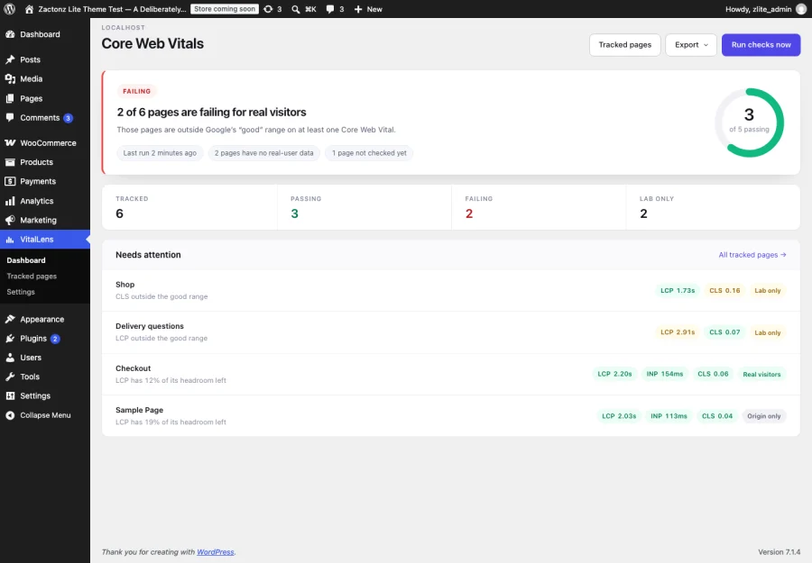
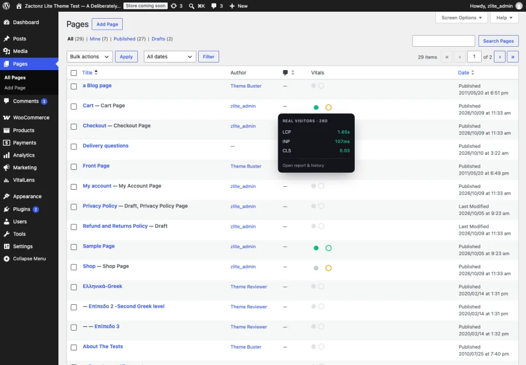
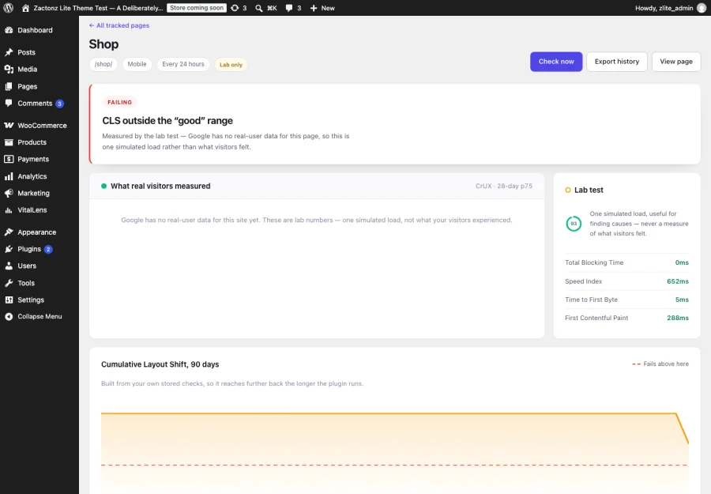
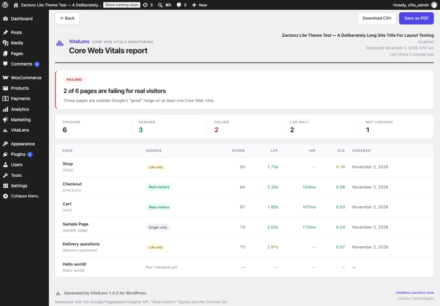

# VitalLens — Core Web Vitals Monitoring for WordPress

**Monitor Core Web Vitals for every page on your WordPress site, see which element is causing
each problem, and get an email before a page starts failing.**

VitalLens is a WordPress plugin that tracks **Largest Contentful Paint (LCP)**, **Interaction
to Next Paint (INP)** and **Cumulative Layout Shift (CLS)** for the pages you choose, using
the Google PageSpeed Insights API. It stores every check, charts the history, names the
element behind each failure, and emails you while a page is still passing but running out of
margin.

**[Full documentation and guides → vitallens.zactonz.com](https://vitallens.zactonz.com/)**

---

## Why Core Web Vitals monitoring matters

Core Web Vitals are part of how Google ranks pages. They measure what a visitor actually
experiences:

| Metric | What it measures | Google's "good" threshold |
|---|---|---|
| **LCP** — Largest Contentful Paint | How long until the main content appears | under 2.5 s |
| **INP** — Interaction to Next Paint | How quickly the page responds to a tap or click | under 200 ms |
| **CLS** — Cumulative Layout Shift | How much the layout jumps while loading | under 0.1 |

Search Console reports these, but it reports them **weeks late, grouped into URL buckets, and
only for pages with enough traffic**. By the time a page appears in a failing group, it has
been failing for a month. VitalLens checks the pages that matter to you on your own schedule
and keeps the full history, so you see a metric drifting long before Google reports it.

## The problem with most Core Web Vitals plugins

**They show you a lab score and let you believe your visitors measured it.**

Google publishes real-user data — the Chrome User Experience Report, or CrUX — only for URLs
with enough traffic. Most individual pages on most sites never qualify. Many tools quietly
fall back to a single simulated page load and present the number identically.

VitalLens labels **every** number as one of three things:

- **Real visitors** — CrUX field data for that exact URL
- **Origin only** — CrUX data for your domain, not that page
- **Lab only** — one simulated load, because Google has no field data for it

A green page nobody has ever measured is worse than no answer at all, because you stop
looking.

### Alerts judged on headroom, not percentages

Judging Core Web Vitals by percentage change does not work. CrUX reports CLS on a 0.01 grid,
so the smallest move a healthy page can make is already a double-digit percentage — which is
why percentage-based alerting either floods you or gets switched off.

VitalLens measures **how much of the remaining margin a change consumed**. A metric that
spends a third of its headroom emails you while it is still passing. One that ticks by a
single grid step does not.

---

## Features

### See Core Web Vitals status on your Posts and Pages lists

A two-dot column shows a filled disc for real-visitor data and a ring for the lab test. Hover
either for the latest LCP, INP and CLS. No separate screen to remember.

### Find out which element is causing the problem

Knowing "CLS 0.16" tells you nothing actionable. VitalLens reads seventeen Lighthouse
diagnostic audits and reports **which element moved, what moved it, and how much of the score
it accounts for** — for example, a 0.162 shift on the block below your hero image, caused by
an image with no explicit dimensions and two web fonts.

That is the difference between knowing you have a problem and knowing what to change.

### Track Core Web Vitals history over time

Every tracked page keeps a chart built from your own stored checks, with the failing threshold
drawn on it. Hover or use arrow keys to read any point. You can see whether last week's change
helped, which Search Console cannot tell you.

### Email alerts before a page fails

Four alerts, each switched on separately:

- A page starts failing for real visitors
- A page is running out of headroom
- A page starts passing again (off by default — good news should be opt-in)
- Checks have stopped running at all

That last one matters more than it sounds. WP-Cron only fires when somebody visits your site,
so on a quiet site monitoring silently stops. VitalLens tells you.

### Client-ready reports and CSV export

Every tracked page in one printable report — branded, with thresholds and data sources stated
— that saves as a PDF from your browser's own print dialog. Plus CSV of every page, or of one
page's complete history.

### Backups that survive deleting the plugin

A snapshot of every tracked page, check and setting is written to your uploads folder each
time the plugin is deactivated — the step before every delete — and restores in one click.
Deleting the plugin cannot take your history with it.

---

## How it works

1. You add a free Google PageSpeed Insights API key in Settings.
2. You choose which pages to track.
3. VitalLens calls the PageSpeed Insights API on a schedule, a few pages at a time.
4. Results are stored in your own database and charted over time.
5. Alerts fire when a metric crosses — or approaches — a threshold.

Nothing is added to your front end: no script, no tracking, no extra requests for visitors, no
effect on the scores being measured.

## What it costs to run

**Nothing, for almost any site.** VitalLens uses your own free PageSpeed Insights API key — no
billing account, 25,000 calls a day.

One call per tracked page per device strategy, per run. Thirty pages checked daily on both
mobile and desktop is roughly **1,800 calls a month** against an allowance of 25,000 a *day*.
The Tracked pages screen shows the exact figure for your selection before you save it.

## Requirements

- WordPress 6.2 or later
- PHP 7.4 or later
- A free [Google PageSpeed Insights API key](https://developers.google.com/speed/docs/insights/v5/get-started)

## Installation

1. Install and activate the plugin.
2. Go to **VitalLens → Settings** and paste your PageSpeed Insights API key. *Test key* tells
   you immediately whether it works.
3. Go to **VitalLens → Tracked pages** and choose what to watch.
4. The first check runs within the hour.

---

## Frequently asked questions

### Why does one of my pages say "lab only"?

Google publishes real-user (CrUX) data only for URLs with enough traffic. Pages below that
threshold are still checked, but the result is one simulated load rather than what visitors
experienced. VitalLens labels it rather than mixing the two.

### What is the difference between Core Web Vitals and a PageSpeed score?

The PageSpeed score out of 100 is a weighted lab result. Core Web Vitals are three specific
metrics, and only the field (real-visitor) versions of them count toward search. A page can
score 95 in the lab and still fail Core Web Vitals for real visitors — which is exactly why
labelling the data source matters.

### Why have my checks stopped running?

WP-Cron only fires when somebody visits your site, so on a low-traffic site it drifts or
stalls entirely. VitalLens flags an overdue run instead of letting the gap pass unnoticed, and
Settings gives you a real system cron command with the paths already filled in for your
install.

### Does this plugin slow down my site?

No. Checks run in the background against Google's API, and nothing is added to the front end.
There is no script for visitors to download and no effect on the metrics being measured.

### Can I export the data?

Yes, three ways: CSV of every tracked page with its latest reading, CSV of one page's full
history, and a printable report that saves as a PDF through your browser. There is no bundled
PDF engine — that would ship megabytes of vendored code to redraw a report the browser already
renders perfectly.

### What happens to my data if I deactivate or delete the plugin?

Nothing, either way, and updating never touches it. Deactivating stops the schedule. Deleting
keeps your tracked pages and stored checks, so reinstalling picks up where you left off —
because deleting a plugin is often just a step in updating it. A tick box on the Settings
screen removes the tables if you genuinely want them gone.

### How many pages can I track?

As many as your API allowance covers, which in practice means more than you need. The limit
worth thinking about is attention, not quota — tracking your twenty most important pages
produces a report you will read.

---

## External service

VitalLens calls `https://www.googleapis.com/pagespeedonline/v5/runPagespeed` directly, using
the key you provide. Each request carries the public URL of a tracked page and that key, and
nothing else: no post content, no visitor data, no personal information, and nothing is sent
to Zactonz or to any server of ours.

Your key is stored in your own database, is never written to a backup snapshot, and is used
only to sign these requests.
[Google's terms of service](https://developers.google.com/terms) ·
[Google's privacy policy](https://policies.google.com/privacy)

## Documentation and support

- **[vitallens.zactonz.com](https://vitallens.zactonz.com/)** — documentation, setup guides and
  how to read each metric
- [Report an issue](https://github.com/zactonz/vitallens-wordpress/issues)
- Full changelog, including the unpublished development builds, is in [readme.txt](readme.txt)

## Licence

GPL-2.0-or-later — see [LICENSE](LICENSE).

Developed by [Zactonz Technologies](https://zactonz.com/), a software engineering practice
building WordPress plugins, APIs and cPanel extensions. Not affiliated with Google.
